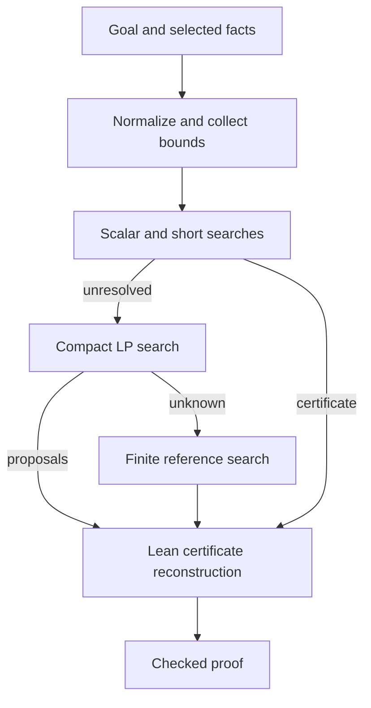

# Design and tradeoffs

## Goal

`norm-arith` should turn proved analytic estimates into a short, checked proof of
the estimate a mathematician wants next. Its core is generic norm arithmetic.
The larger direction includes seminorms, operator estimates, products, Hölder
and interpolation choices, and absorption of error terms in energy inequalities.

Search discovers a derivation; Lean checks it. Keeping these responsibilities
separate allows stronger search without accepting solver output as a proof.

## Modules

| Module | Responsibility |
| --- | --- |
| `NormArith.Certificate` | Proved sum, scalar-multiplication, and norm-certificate lemmas |
| `NormArith.Search` | Exact rational elimination, small-support search, finite reference enumeration |
| `NormArith.LP` | Rational LP encoding, exact simplex search, certificate validation and extraction |
| `NormArith.Metric` | Bounded collection of proved distance constraints in pseudometric spaces |
| `NormArith.Tactic` | Syntax, hypothesis selection, normalization, dispatch, proof reconstruction |
| `NormArith.Seminorm` | Explicit seminorm facts and bounded `seminorm_arith` automation |
| `NormArith.Analysis` | `analytic_estimate`, operator/absorption lemmas, finite-`Lp` adapters |

`import NormArith` exposes the norm tactic. Analysis remains an explicit import,
so a user needing norm arithmetic need not import the full analytic frontend.
Tests and benchmarks are separate from the public library. Default builds do
not request native precompilation of the whole dependency library; this avoids
a large first-use build unrelated to importing the tactic.

## Norm pipeline

The frontend selects hypotheses, normalizes recognized metric notation, and
specializes bounded local quantified estimates. Scalar, structural, and short
decomposition searches handle easy goals. Harder affine norm goals go to the
compact LP. Finite decomposition enumeration remains a fallback, including
integer-safe certificates for additive groups.

Supporting-functional coordinates exist only inside search. They are never
asserted as unproved hypotheses. The LP result becomes rational vector
decompositions; the frontend proves the actual vector identities and norm bounds,
then invokes checked scalar arithmetic. The exact oracle comes from the pinned
mathlib dependency. No external solver or floating-point tolerance is required.

## Why keep several strategies?

| Approach | Advantage | Cost or limitation |
| --- | --- | --- |
| Structural bounds | Low overhead for obvious triangle estimates | Miss hidden decompositions |
| Small-support rational search | Often finds short certificates | Deliberately small support budget |
| Supporting-functional LP | Avoids enumerating candidate supports; handles coupled norm inequalities | Quadratic row count, rational coefficient growth, simplex overhead |
| Finite reference enumeration | Fallback and independent algorithm for comparison | Number of supports can grow combinatorially |
| Analytic theorem composition | Adds domain knowledge for products, operators, and absorption | Bounded and incomplete; needs the correct analytic hypotheses |

A polynomial-size LP formulation does not make this simplex implementation
polynomial-time or guarantee small proof terms. For easy examples, short search
may be faster. Evaluation should include both easy examples and forced LP cases.

## Analytic frontend

`analytic_estimate` collects a bounded set of checked norm, seminorm, and operator
facts, recognizes bilinear perturbations, and tries norm and scalar automation.
Its optional facts are additional proofs. `seminorm_arith [facts]` is also
additive; `norm_arith [facts]` retains its selective semantics for norm premises.

Scalar products are not silently made linear with variable coefficients.
Monotonicity and polynomial consequences are handled by checked analytic rules
and `nlinarith`. Dedicated templates cover Young's inequality, absorption,
small-drift scalar estimates, and quadratic contraction estimates.

The current layer does not search arbitrary theorem databases or automatically
choose Sobolev embeddings, exchange mixed-norm order, or invent measurability,
integrability, exponent, and smallness hypotheses.

## Finite and extended-real norms

Bundled spaces such as `Lp E p μ` use the norm frontend when the required instances
exist. A raw `eLpNorm f p μ` lies in `ℝ≥0∞`; moving it to real arithmetic requires
a finite bound or membership proof. Checked adapters keep these hypotheses
visible. Different explicit seminorms remain different expressions. A bound
`p x ≤ C * q x` is an analytic premise, not a consequence of their names. A zero
seminorm does not imply its argument is zero.

## Limits and diagnostics

The LP configuration bounds observations, dimension, rows, and variables; other
frontends bound term collection and specialization. Lean's heartbeat limit also
applies. Failure can mean missing hypotheses, unsupported syntax, exhausted
resources, or a false goal. This version does not return a feasible point as a
countermodel. `norm_arith?` reports a successful search, and backend options allow
direct LP regression checks independently of the fallback.

Every successful result passes Lean's checker. Metaprogram tests also reject bad
weights, malformed dimensions, and invalid strictness. Expected-failure examples
guard explicit-fact selection, missing real homogeneity, and false analytic claims.

## Independent package and eventual mathlib contribution

The package owns the `NormArith` namespace and imports pinned mathlib. It has no
dependency-patching step. Consumers require this Git repository and import its
public modules. A separate consumer project is part of release verification.

Separating proof lemmas, theorem adapters, search, and frontend code makes a later
mathlib contribution easier to review. It still requires discussion, dependency
trimming, API and naming review, and tests against the then-current mathlib.
No mathlib port or upstream patch is performed on this branch.

## Keeping the layout simple

Reusable implementation belongs in `NormArith/`, checked examples and failures
in `NormArithTest/`, real-source pairs in `Benchmarks/`, and explanations here.
Every new snippet needs provenance in the manifest. Synthetic stress tests must
be labeled separately from mathlib-derived results. Update measured claims only
after their checks run.

Generated papers, duplicated census archives, machine-specific paths, and
transient build output are excluded from the working tree. Earlier evidence is
linked from [history](history.md).
